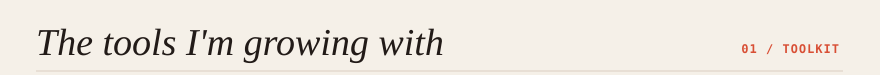
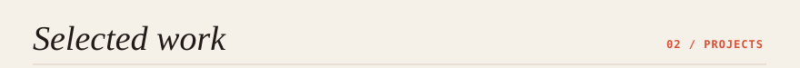

<!-- Original editorial-style animated SVG system. All stats are refreshed from real GitHub data. -->

 
 
 
 
 
 
 
 

  <a href="https://github.com/ronartz?tab=repositories">projects</a> &nbsp; / &nbsp;
  <a href="https://www.linkedin.com/in/shreejitmondal">linkedin</a> &nbsp; / &nbsp;
  <a href="mailto:s.mondal.grc@gmail.com">email</a>

