  
  
  

  
  
  

**Hey, I'm Shreejit.** I'm a BCA (Honours) student from India, graduating in **2027**, learning **Python, backend engineering, RAG/LLMs, and cloud fundamentals**. I built [SHINPO](https://github.com/ronartz/SHINPO) with extensive AI-assisted coding, and I'm now focusing on understanding the code and becoming more independent as a developer. I'm also studying elementary Japanese.

  
  
  
  

  <a href="https://github.com/ronartz?tab=repositories">PROJECTS</a> &nbsp;·&nbsp;
  <a href="https://www.linkedin.com/in/shreejitmondal">LINKEDIN</a> &nbsp;·&nbsp;
  <a href="mailto:s.mondal.grc@gmail.com">EMAIL</a> &nbsp;·&nbsp;
  <a href="./scripts/render_readme_cards.py">HOW IT WORKS</a>
   
  Learn · Build · Understand · Improve &nbsp;|&nbsp; 進歩

  
🐍 Bonus: my animated contribution snake

  

<!-- All main SVG cards are rendered by scripts/render_readme_cards.py from
     GitHub's real contribution calendar, via .github/workflows/readme-cards.yml.
     STATIC=1 disables motion for static previews. -->
