<!-- Richardt-inspired dark orange card layout.
     Cards sharing a row intentionally have no whitespace between img tags.
     All cards are generated by scripts/render_readme_cards.py using actual GitHub contributions. -->

<a href="https://github.com/ronartz"></a>


<a href="https://github.com/ronartz?tab=overview"></a>


<a href="https://github.com/ronartz/SHINPO"></a><a href="#toolkit"></a><a href="#toolkit"></a>


<a href="https://github.com/ronartz/SHINPO"></a><a href="https://github.com/ronartz/skill-track"></a><a href="https://github.com/ronartz/Titanic-Survival-Prediction"></a>



<a href="https://github.com/ronartz"></a><a href="https://www.linkedin.com/in/shreejitmondal"></a>

