<div align="center">



<br/>

<a href="https://github.com/DenverCoder1/readme-typing-svg">
  
</a>

<br/>

<a href="https://github.com/ronartz"></a>
<a href="https://www.linkedin.com/in/shreejitmondal"></a>
<a href="mailto:s.mondal.grc@gmail.com"></a>

<br/><br/>


<br/><br/>

<a href="#about">About</a> &nbsp;•&nbsp;
<a href="#journey">Journey</a> &nbsp;•&nbsp;
<a href="#stack">Tech Stack</a> &nbsp;•&nbsp;
<a href="#projects">Projects</a> &nbsp;•&nbsp;
<a href="#stats">GitHub Stats</a> &nbsp;•&nbsp;
<a href="#connect">Connect</a>

</div>

<div align="center"></div>

<a id="about"></a>

## ⚡ About Me

Hi, I'm **Shreejit Mondal** — a BCA (Honours) student from West Bengal, India, graduating in **2027**.

I'm exploring **Python, backend systems, AI applications and cloud computing** through coursework, experiments and personal projects. I built **SHINPO**, a local-first productivity app, with extensive AI-assisted coding; I'm now concentrating on understanding programming fundamentals and developing independent engineering skills.

My long-term goal is to build useful software and pursue technology opportunities in Japan.

```python
class Developer:
    def __init__(self):
        self.name = "Shreejit Mondal"
        self.github = "ronartz"
        self.education = "BCA (Honours), 2023–2027"
        self.location = "West Bengal, India"
        self.focus = ["Python", "Backend", "AI / RAG", "Cloud"]
        self.learning_japanese = True

    def motto(self):
        return "Learn. Build. Understand. Improve."
```

<div align="center"></div>

<a id="journey"></a>

## 🧭 My Development Journey

I'm working to turn early hands-on exposure into **skills I can explain, test and use independently**.

<details open>
<summary><b>🐍 01 — Python &amp; Backend Foundations</b></summary>

<br/>

- Practising Python fundamentals, data structures and problem solving.
- Learning SQL queries, relational database concepts and API design.
- Exploring cloud concepts through AWS Lambda, S3, API Gateway, DynamoDB and IAM.
- Building toward independently implemented Python REST APIs.

**Next:** Python fundamentals → SQL → FastAPI.

</details>

<details>
<summary><b>💻 02 — Desktop &amp; Web Projects</b></summary>

<br/>

- **SHINPO:** an AI-assisted desktop productivity project using React, TypeScript and Tauri.
- **Skill Track:** student skill/progress tracking project associated with a college hackathon.
- Exploring web interfaces, Git workflows and debugging through personal work.

</details>

<details>
<summary><b>🧠 03 — AI, Cloud &amp; Next Steps</b></summary>

<br/>

| Area | Current direction |
|:---|:---|
| Python fundamentals | Practising |
| FastAPI + SQL | Learning plan |
| RAG and LLM APIs | Upcoming project |
| AWS + Linux + Docker | Foundational exposure; deepening |
| Japanese language | Elementary; continuing |

</details>

<div align="center"></div>

<a id="stack"></a>

## ⚔️ Tech Stack

<div align="center">

### Languages &amp; Application Development


<br/><br/>

### Cloud, Tools &amp; Environment


<br/><br/>


<p><sub>Tools I've explored through coursework, projects and AI-assisted development—not a claim of professional mastery.</sub></p>

</div>

<div align="center"></div>

<a id="projects"></a>

## 🌌 Featured Projects

<div align="center">
<table>
<tr>
<td width="50%" valign="top">

### 🎯 SHINPO (進歩)

A local-first productivity desktop app for Linux and Windows, developed through **extensive AI-assisted coding** and iteration.

<sub>React · TypeScript · Tauri</sub>

<br/><br/>
<a href="https://github.com/ronartz/SHINPO"></a>

</td>
<td width="50%" valign="top">

### 📈 Skill Track

A student progress and skill-tracking application associated with a college hackathon.

<br/><br/>
<a href="https://github.com/ronartz/skill-track"></a>

</td>
</tr>
<tr>
<td width="50%" valign="top">

### 🚢 Titanic Survival Prediction

A data science learning project using logistic regression for a basic supervised-learning workflow.

<sub>Python · Machine Learning</sub>

<br/><br/>
<a href="https://github.com/ronartz/Titanic-Survival-Prediction"></a>

</td>
<td width="50%" valign="top">

### ☕ Java Exercises (OIBSIP)

Java exercises and introductory programming tasks from a self-paced learning program.

<sub>Java · Object-Oriented Programming</sub>

<br/><br/>
<a href="https://github.com/ronartz/OIBSIP"></a>

</td>
</tr>
</table>
</div>

<details>
<summary><b>📂 More Work &amp; Practice</b></summary>

<br/>

- [Portfolio Code](https://github.com/ronartz/Portfolio-code) — HTML/CSS and portfolio experiments.
- [All GitHub repositories](https://github.com/ronartz?tab=repositories).

</details>

<div align="center"></div>

<a id="stats"></a>

## 📊 GitHub Analytics

<div align="center">


<br/><br/>


<br/><br/>


<br/><br/>


</div>

<div align="center"></div>

## 🏆 Beyond the Code

- 🎓 BCA (Honours), 2023–2027.
- 🏅 Cleared the college-level Smart India Hackathon selection round.
- 🧪 Completed learning activities and virtual job simulations in software engineering and data analytics.
- ☁️ Exploring Python, AWS cloud foundations and applied AI.
- 🇯🇵 Studying elementary Japanese and interested in future technology opportunities in Japan.

<div align="center"></div>

<a id="connect"></a>

<div align="center">

## 🤝 Let's Connect

I enjoy learning, discussing ideas and building useful software. I'm especially interested in beginner-friendly technical collaboration and feedback.

<br/>

<a href="https://github.com/ronartz"></a>
<a href="https://www.linkedin.com/in/shreejitmondal"></a>
<a href="mailto:s.mondal.grc@gmail.com"></a>

<br/><br/>

**⭐ Thanks for visiting!**

*Progress, one understandable build at a time. · 進歩*

</div>
